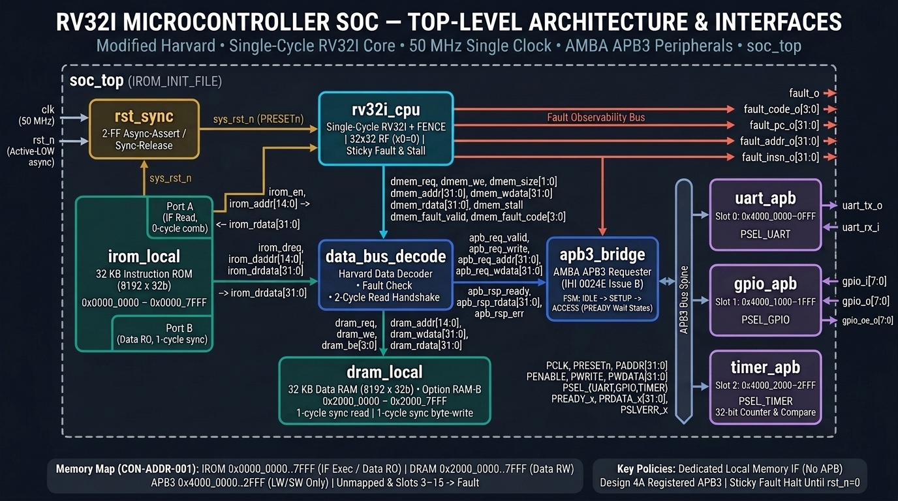
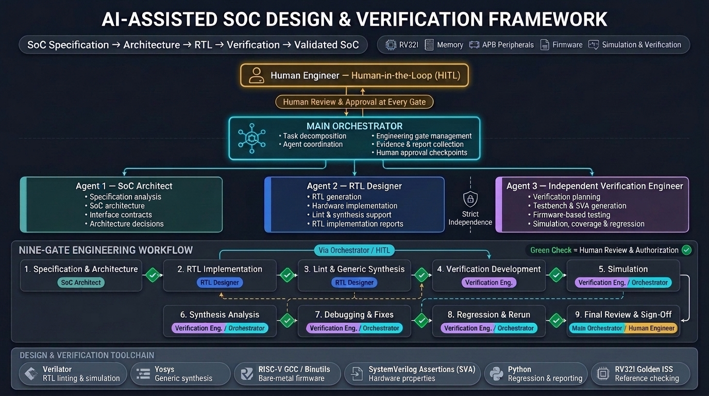

# AI-Assisted RV32I Microcontroller SoC Design & Verification

An AI-assisted hardware engineering project focused on designing, implementing, and verifying a custom **RV32I-based microcontroller System-on-Chip (SoC)** using a structured, human-supervised multi-agent workflow.

The project combines digital hardware design, bare-metal firmware, simulation, assertions, synthesis analysis, and AI-agent orchestration across nine engineering gates.

## Project Overview

The target is a custom 32-bit RISC-V microcontroller SoC featuring:

- A single-cycle RV32I processor.
- Modified Harvard architecture.
- Dedicated instruction ROM and data RAM.
- AMBA APB3 peripheral subsystem.
- UART, GPIO, and Timer peripherals.
- Bare-metal firmware execution.
- Fault reporting and controlled CPU halt behavior.

The engineering process is supported by a multi-agent AI framework in which specialized agents handle architecture, RTL implementation, and independent verification, coordinated by a Main Orchestrator.

**Human approval remains part of every engineering gate.** AI agents propose and execute assigned engineering tasks, while the human engineer reviews evidence and authorizes progression.

## System Architecture



### Main Components

| Component | Description |
|---|---|
| `rv32i_cpu` | Single-cycle RV32I CPU with 32 × 32-bit registers and x0 hardwired to zero |
| `irom_local` | 32 KB instruction ROM with instruction-fetch and read-only data access ports |
| `dram_local` | 32 KB data RAM with synchronous read and byte-write support |
| `data_bus_decode` | Modified Harvard data-address decoding and fault handling |
| `apb3_bridge` | Registered-output AMBA APB3 requester bridge |
| `uart_apb` | Memory-mapped UART peripheral |
| `gpio_apb` | Memory-mapped GPIO peripheral |
| `timer_apb` | 32-bit timer and compare peripheral |
| `rst_sync` | Asynchronous-assert, synchronous-deassert reset synchronizer |

### Key Architectural Characteristics

- **Processor:** RV32I base integer instruction set.
- **Architecture:** Modified Harvard.
- **Clock:** Shared 50 MHz clock.
- **Instruction memory:** 32 KB IROM.
- **Data memory:** 32 KB DRAM.
- **Peripheral bus:** AMBA APB3.
- **Reset:** Active-low external reset with synchronized internal release.
- **Memory-mapped peripherals:** UART, GPIO, and Timer.
- **Fault policy:** Fault observability with sticky fault and CPU halt behavior.

### Memory Map

| Region | Base address | Size | Access |
|---|---:|---:|---|
| IROM | `0x00000000` | 32 KB | Instruction fetch / read-only data |
| DRAM | `0x20000000` | 32 KB | Read / write |
| UART | `0x40000000` | 4 KB slot | APB3 |
| GPIO | `0x40001000` | 4 KB slot | APB3 |
| Timer | `0x40002000` | 4 KB slot | APB3 |

APB peripheral accesses follow the project's aligned 32-bit access policy.

## AI-Assisted Engineering Framework



The project uses a Main Orchestrator and three specialized agents:

| Agent | Responsibility |
|---|---|
| Main Orchestrator | Task decomposition, agent coordination, engineering gate management, and evidence collection |
| SoC Architect | Specification analysis, architecture definition, and interface contracts |
| RTL Designer | RTL generation, hardware implementation, lint, and synthesis support |
| Independent Verification Engineer | Verification planning, testbench and SVA development, firmware-based testing, simulation, and regression |

The Verification Engineer maintains independence from RTL implementation to support objective verification.

### Nine Engineering Gates

1. **Specification & Architecture** — requirements, architecture, and interface contracts.
2. **RTL Implementation** — synthesizable SystemVerilog design.
3. **Lint & Generic Synthesis** — RTL quality checks and synthesis analysis.
4. **Verification Development** — testbench, assertions, reference models, and coverage.
5. **Simulation** — functional verification and debugging evidence.
6. **Synthesis Analysis** — review of synthesis results and hardware implications.
7. **Debugging & Fixes** — controlled issue resolution.
8. **Regression & Rerun** — verification after approved changes.
9. **Final Review & Sign-Off** — consolidated evidence and human engineering approval.

Human review and authorization are required at every gate. Verification failures do not authorize silent RTL modifications, weakened tests, or automatic sign-off.

## Verification and Implementation

The project uses a combination of static checks, simulation, assertions, firmware-based testing, and synthesis analysis.

### Verification Features

- Directed SystemVerilog testbenches.
- SystemVerilog Assertions (SVA).
- RV32I instruction-level checking with a Golden ISS.
- Bare-metal firmware execution.
- Local memory and APB peripheral testing.
- Reset and fault-condition testing.
- Regression automation and coverage reporting.
- Gate-level simulation with SDF as part of the verification/sign-off workflow.

### Reported Regression Results

The reported Gate 5 regression milestone includes:

| Metric | Result |
|---|---:|
| Test cases passed | 68 |
| Test cases failed | 0 |
| SVA errors | 0 |
| Regression exit status | 0 |

These results represent the reported regression run, not a claim of exhaustive verification of every possible behavior.

### RTL Quality and Synthesis

- Verilator lint completed with zero errors and zero warnings in the reported RTL-001 run.
- Yosys generic synthesis completed with zero latches and zero structural check problems in the reported run.
- Synthesis findings and implementation trade-offs are documented for engineering review.

## Bare-Metal Firmware Demonstration

A firmware demonstration was built for the custom RV32I processor and simulated through the integrated `soc_top`.

The demonstration exercises:

1. CPU arithmetic operations.
2. DRAM write/readback.
3. GPIO configuration and output.
4. UART transmission.
5. Timer configuration and polling.
6. Final GPIO completion indication.

### Observed Demonstration Outputs

| Signal / Function | Observed behavior |
|---|---|
| GPIO initial pattern | `0xA5` |
| GPIO final pattern | `0x5A` |
| GPIO output enable | `0xFF` |
| UART | 11 characters monitored |
| CPU fault output | `0` |

The GPIO transition and UART activity were observed in the Vivado simulation waveform.

### Firmware Build Flow

The firmware toolchain uses the RISC-V GNU compiler and binutils.

The general conversion flow is:

```text
C / Assembly Source
        |
        v
RISC-V GCC / Assembler
        |
        v
       ELF
        |
        v
     objcopy
        |
        v
       BIN
        |
        v
  Memory Image Generator
        |
        v
      .mem
        |
        v
      IROM
```

The resulting memory image is loaded into the instruction ROM using `$readmemh` during simulation.

## Toolchain

| Tool | Usage |
|---|---|
| Verilator | RTL linting and simulation |
| Yosys | Generic synthesis |
| RISC-V GNU GCC | RV32I bare-metal firmware compilation |
| GNU Binutils | Assembler, linker, objcopy, and objdump |
| SystemVerilog Assertions | Hardware property checking |
| Python | Regression automation, image conversion, and reporting |
| RV32I Golden ISS | Reference instruction checking |
| Vivado / XSim | Integrated SoC simulation |

## Repository Structure

The repository is organized around RTL, verification, documentation, firmware, and regression evidence.

```text
.
├── rtl/
│   ├── soc_pkg.sv
│   ├── rst_sync.sv
│   ├── rv32i_cpu.sv
│   ├── irom_local.sv
│   ├── dram_local.sv
│   ├── data_bus_decode.sv
│   ├── apb3_bridge.sv
│   ├── uart_apb.sv
│   ├── gpio_apb.sv
│   ├── timer_apb.sv
│   ├── soc_top.sv
│   └── rtl.f
├── verification/
│   ├── tb/
│   ├── sva/
│   ├── firmware/
│   └── ...
├── demo/
│   ├── firmware/
│   ├── tb/
│   └── README.md
├── docs/
│   ├── specifications/
│   ├── architecture/
│   ├── contracts/
│   ├── decisions/
│   ├── reports/
│   └── images/
│       ├── ai_soc_workflow_infographic.jpg
│       └── rv32i_soc_top_architecture.jpg
├── regression/
│   └── runs/
└── ...
```

*The tree above highlights the main project areas; consult the repository for the exact current directory contents.*

## Getting Started

### Prerequisites

The main development and verification environment uses:

- Linux / WSL.
- Verilator.
- Yosys.
- Python 3.
- RISC-V GNU GCC and Binutils.
- Vivado / XSim for the integrated simulation demonstration.

### RISC-V Toolchain

On Ubuntu / WSL:

```bash
sudo apt-get update

sudo apt-get install -y \
    gcc-riscv64-unknown-elf \
    binutils-riscv64-unknown-elf
```

For RV32I firmware compilation, use:

```bash
-march=rv32i -mabi=ilp32
```

### RTL Lint

From the repository root:

```bash
verilator --lint-only -Wall \
    --top-module soc_top \
    -f rtl/rtl.f
```

### Generic Synthesis

The project uses Yosys for generic synthesis and structural checks. Refer to the project scripts and reports for the exact synthesis flow.

### Regression

The verification environment provides a Python-driven regression flow. Refer to the verification README and regression scripts for the current run instructions.

## Engineering Principles

This project follows several important engineering principles:

- Specification-driven RTL development.
- Explicit architecture and interface contracts.
- Independent verification ownership.
- Human-in-the-Loop engineering approval.
- Evidence-based gate progression.
- Controlled debugging and change management.
- Reproducible simulation and regression.
- Traceability between requirements, implementation, verification, and reports.

## Project Status

The project has progressed through RTL implementation, linting, generic synthesis, verification development, simulation, and regression milestones.

A reported 68-test regression completed successfully, and an integrated bare-metal firmware demonstration was observed in simulation.

Final engineering sign-off remains a human review activity. Reported test results should be interpreted within their documented scope and limitations.

## Author

**Omar Ashraf Abd El Mongy**

Electronics & Communication Engineering  
Digital Hardware Design | FPGA | ASIC | AI-Assisted Hardware Engineering

---

*This repository documents an educational and engineering project exploring the combination of traditional digital hardware design methodologies with structured, human-supervised AI-agent workflows.*
